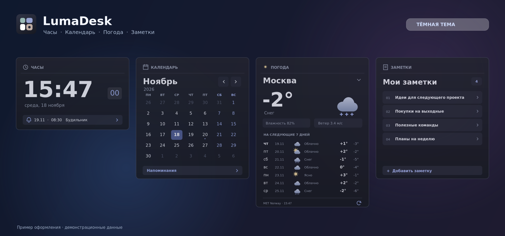
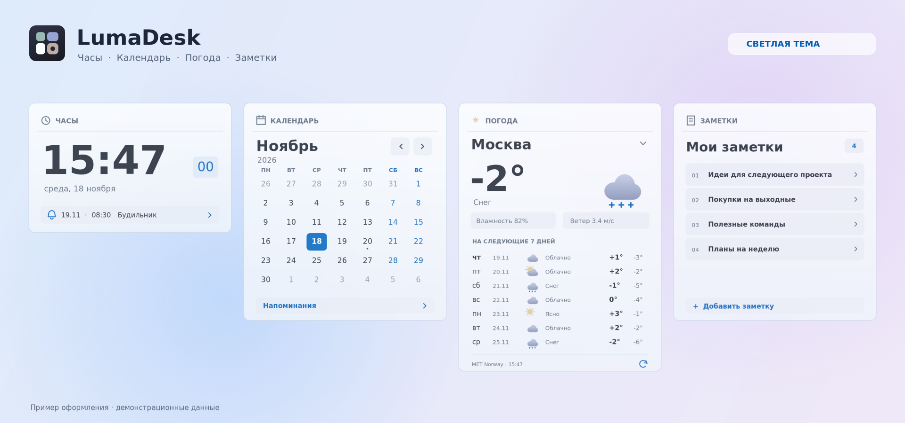

## Как выглядит LumaDesk

### Тёмная тема



### Светлая тема



# LumaDesk

## Возможности

- Часы с будильниками, повторами и откладыванием сигнала.
- Календарь с напоминаниями.
- Погода и встроенный справочник российских городов.
- Заметки с добавлением, редактированием и удалением.
- Светлая тема в стиле Windows 11 и тёмная тема.
- Настройка прозрачности, сохранение положения и видимости.
- Прилипание, выравнивание и блокировка перемещения.
- Регистрация и синхронизация через собственный сервер.

## Запуск

1. Скачайте и распакуйте архив из раздела Releases.
2. Запустите `LumaDesk.exe`.
3. Настройки находятся в меню значка в трее и по правой кнопке на виджете.

Требуется .NET Framework 4.8. Перед обновлением закройте предыдущую версию
через меню трея → «Выход». Будильники работают при запущенной программе;
программа не будит спящий или выключенный компьютер.

Выбор темы: **трей → Тема оформления → Светлая · Windows 11 / Тёмная**.

## Исходники и сборка

Клиент написан на C# с Windows Forms, исходники находятся в `Source/`.
Чтобы собрать клиент из исходников, уберите готовый EXE из папки проекта
и запустите `Start.cmd` на Windows с установленным .NET Framework 4.8.

Проверки клиента: `Tests/RunChecks.cmd`.
Зависимости и источники данных: [ThirdPartyNotices.txt](ThirdPartyNotices.txt).

## Свой сервер

Сервер написан на Python. Данные и аккаунты хранятся на вашем VPS.
Адрес сервера указывается пользователем в клиенте.

- [Установка с доменом](Server/README.md).
- [Установка по публичному IPv4 без домена и Nginx](Server/README-IP.md).

Для Ubuntu 22.04 из папки `Server/`:

```bash
sudo bash install-ubuntu22-ip.sh YOUR_SERVER_IP
```

Замените `YOUR_SERVER_IP` на публичный IPv4 вашего VPS.
Адрес сервера по умолчанию не задан. Файлы `.env.example` и `.env.ip.example`
содержат только шаблоны. Личные конфигурации, ключи, базы и данные аккаунтов
не следует добавлять в репозиторий.

Без аккаунта заметки, события и настройки сохраняются локально.
Положения виджетов и тема оформления остаются отдельными для каждого ПК.

## Версия 2.4

Добавлена светлая тема и убраны кнопки с тремя точками из заголовков.
Клиент совместим с сервером 2.1. Полный запуск этой версии на Windows
ещё требует проверки; сборка и автоматические проверки выполнены.
