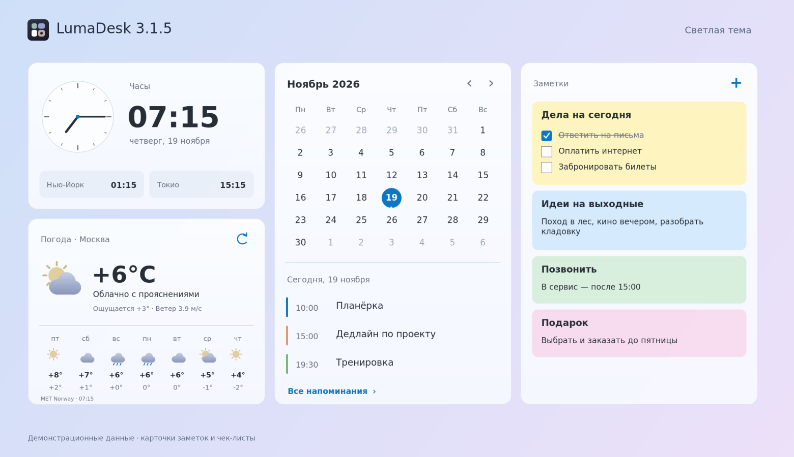
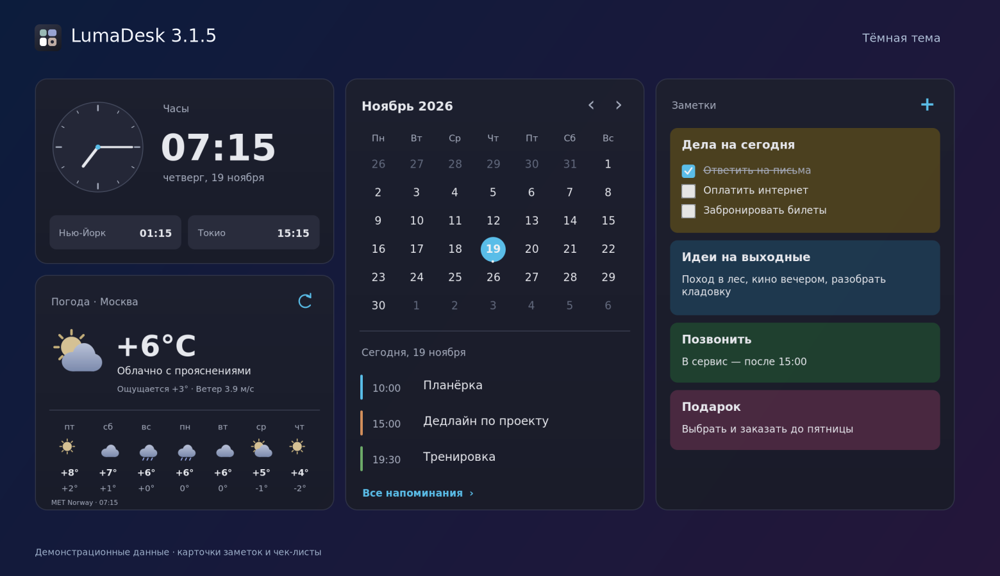

# LumaDesk

Полупрозрачные виджеты для рабочего стола Windows: часы, погода, календарь и заметки с синхронизацией между компьютерами.

## Виджеты

### 🕒 Часы
- Аналоговые и цифровые часы.
- Два дополнительных города с выбором часового пояса.
- Будильники с мелодиями и повторением по дням недели.

### 📅 Календарь
- Календарь месяца и события выбранного дня.
- Напоминания с уведомлениями и звуком.
- Возможность отложить сработавшее уведомление.

### 🌤 Погода
- Выбор города и прогноз на семь дней.
- Температура, влажность и скорость ветра.
- Автоматическое обновление и отдельная кнопка обновления.
- Источники данных: MET Norway и Open-Meteo.

### 📝 Заметки
- Цветные карточки с заголовком и текстом.
- Списки задач с отметками выполнения.
- Создание и редактирование заметок прямо из виджета.

## Оформление и управление

- Светлая и тёмная темы.
- Настройка прозрачности.
- Подсветка доступных действий при наведении.
- Сохранение положения виджетов.
- Прилипание к краям экрана и соседним виджетам.
- Запрет перемещения и управление видимостью через трей.
- Автозапуск при входе в Windows.

## Синхронизация

Заметки, события и общие настройки синхронизируются через собственный сервер LumaDesk.

Изменения отправляются после небольшой паузы, проверка удалённых изменений выполняется раз в 15 минут. Доступны ручная синхронизация и отключение обычной автосинхронизации.

Положение виджетов, выбранная тема и параметры автозапуска сохраняются отдельно на каждом компьютере.

Без аккаунта программа работает локально.

### Общая остановка будильников

Выключите сработавший будильник или напоминание на одном компьютере — его окно и звук отключатся на остальных подключённых устройствах того же аккаунта.

Остановка относится только к текущему срабатыванию: следующие повторы будильника остаются включёнными.

Для этой функции нужны:
- LumaDesk 3.2.0 на всех устройствах;
- сервер LumaDesk 2.2;
- подключение устройств к одному аккаунту и доступ к серверу.

Обычно остановка передаётся за несколько секунд. При потере связи команда сохраняется и отправляется после восстановления подключения, пока программа запущена.

Частая проверка остановки выполняется только при открытом уведомлении. Она работает отдельно от обычной синхронизации заметок.

## Установка

1. Скачайте ZIP-архив из раздела Releases.
2. Распакуйте его в отдельную папку.
3. Запустите LumaDesk.exe.
4. Настройте виджеты через значок в системном трее.

Для автозапуска включите «Запускать при входе в Windows» в настройках и сохраните изменения.

## Обновление

1. Закройте предыдущую версию через трей → «Выход».
2. Распакуйте новую версию и запустите LumaDesk.exe.
3. Если используете автозапуск, сохраните настройки с включённым автозапуском — это обновит постоянную копию программы.

Локальные данные находятся в:
%LOCALAPPDATA%\LumaDesk

Для общей остановки будильников обновите сервер по инструкции:
Server/UPDATE-2.2.md

## Требования

- Windows 10 или Windows 11.
- .NET Framework 4.8.
- Интернет — для получения погоды и синхронизации.

Будильники работают, пока программа запущена. Они не включают выключенный компьютер и не будят его из сна.

## Собственный сервер

Серверная часть и инструкции по развёртыванию находятся в папке Server.

Сервер использует Python, FastAPI и SQLite. Для удалённого подключения нужен HTTPS.

## Обратная связь

Нашли ошибку или хотите предложить улучшение? Создайте Issue и укажите версию программы, версию Windows и шаги для повторения проблемы.

## Внешний вид

### Светлая тема

### Тёмная тема

